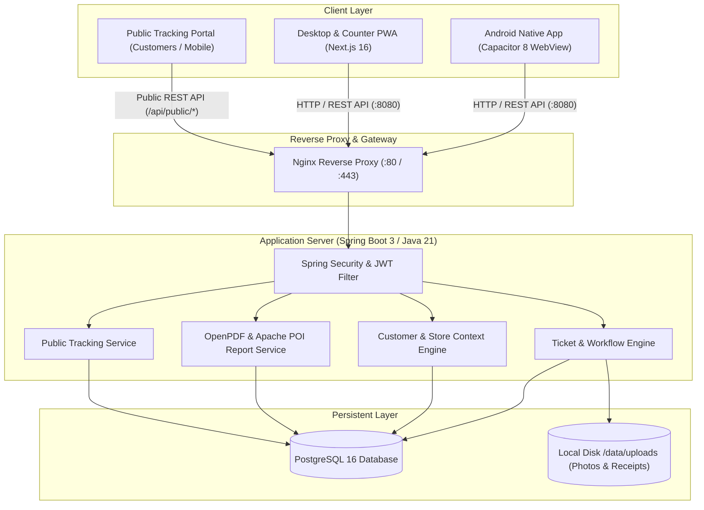

# Project Review: Famous Mobiles (Web PWA & Android Staff App)

**Date of Review:** November 9, 2026  
**Reviewer:** Senior Full-Stack & Android Systems Engineer  
**Scope:** Architecture, Code Quality, Android/Play Store Readiness, Performance, Security, UX/Accessibility, and DevOps.  
**Branch:** `feature/convertandriodapp`

---

## 1. Project Overview & Architecture

### What the Application Does
**Famous Mobiles** is an omnichannel repair shop management and tracking system built for two shop branches in Hyderabad (Manikonda & New Famous). It handles:
- **Device Intake**: Counter device check-in with condition checklists, customer mobile auto-matching, and mandatory camera photo attachments.
- **Workshop Queue**: Diagnostic workflows, technician ticket assignment, status progression, and spare parts requisition.
- **Stock & Demands**: Wholesaler accessory ordering with automated accessory categorization, WhatsApp notifications, and sanitized supplier clipboard sharing.
- **Billing & Receipts**: Advance payment handling, balance calculation, QR-coded PDF receipt generation, and landscape financial reports (PDF & Excel).
- **Public Tracking Portal**: Customers scan QR codes on receipts or enter tracking tokens (`FM-2026-XXXXXX`) to track progress in real-time.

### System Architecture Diagram



---

## 2. Comprehensive Findings Table

| ID | Area | Severity | File:line | Issue | Recommended Fix | Effort |
| :--- | :--- | :---: | :--- | :--- | :--- | :---: |
| **SEC-01** | Security | **Critical** | [`PublicTrackingController.java:45-54`](file:///Users/mohammedmubasheeruddin/Desktop/FamousMobiles/backend/src/main/java/com/famousmobiles/controller/PublicTrackingController.java#L45-L54) | **Public Receipt IDOR / PII Leak**: Public endpoint `GET /api/public/track/{trackingNumber}/receipt/pdf` generates full customer receipts containing customer full name, mobile number, and repair costs. Because tracking numbers are sequential predictable integers (`FM-2026-000001`, `000002`), anyone can crawl and extract the entire shop customer database. | Require phone verification (e.g. matching last 4 digits) or use an unguessable UUID token / verification hash for public receipt access. | **S** |
| **PERF-01** | Performance | **High** | [`DashboardService.java:48-74`](file:///Users/mohammedmubasheeruddin/Desktop/FamousMobiles/backend/src/main/java/com/famousmobiles/service/DashboardService.java#L48-L74), [`93-102`](file:///Users/mohammedmubasheeruddin/Desktop/FamousMobiles/backend/src/main/java/com/famousmobiles/service/DashboardService.java#L93-L102) | **Unbounded In-Memory Stream Aggregations**: `DashboardService` executes `ticketRepository.findAll()` and `paymentRepository.findAll()` on every dashboard load, filtering records in Java heap memory. At scale, this leads to heavy garbage collection pauses and slow page loads. | Replace with targeted SQL/JPQL aggregation queries (`COUNT`, `SUM(p.amount) WHERE p.createdAt >= ...`). | **S** |
| **PERF-02** | Scalability | **High** | [`TicketController.java:27-30`](file:///Users/mohammedmubasheeruddin/Desktop/FamousMobiles/backend/src/main/java/com/famousmobiles/controller/TicketController.java#L27-L30), [`CustomerController.java:27-30`](file:///Users/mohammedmubasheeruddin/Desktop/FamousMobiles/backend/src/main/java/com/famousmobiles/controller/CustomerController.java#L27-L30) | **Unpaged List Endpoints**: `GET /api/tickets` and `GET /api/customers` dump the entire database tables as unpaged JSON arrays. As tickets reach thousands, network payload will exceed 20MB. | Implement Spring Data `Pageable` (`page`, `size`) and infinite scrolling or pagination on the frontend. | **M** |
| **AND-01** | Android / Perf | **High** | [`MainActivity.java:25-34`](file:///Users/mohammedmubasheeruddin/Desktop/FamousMobiles/frontend/android/app/src/main/java/com/famousmobiles/staff/MainActivity.java#L25-L34) | **Webview Cache Purged on Resume**: `webView.clearCache(true)` runs on every `onResume`. Every time staff switches to Camera or WhatsApp and returns, assets are purged from memory, degrading performance. Also allows insecure mixed content. | Remove `clearCache(true)` on resume, disable `allowFileAccess`, and restrict mixed content mode. | **S** |
| **AND-02** | Play Store / Sec | **High** | [`app/build.gradle:19-25`](file:///Users/mohammedmubasheeruddin/Desktop/FamousMobiles/frontend/android/app/build.gradle#L19-L25), [`AndroidManifest.xml:7`](file:///Users/mohammedmubasheeruddin/Desktop/FamousMobiles/frontend/android/app/src/main/AndroidManifest.xml#L7) | **Debug Build, No Release Keystore, `allowBackup=true`**: Built with `debug.keystore`, `debuggable=true`, and `allowBackup=true`. Attackers can extract auth tokens via `adb backup`. Google Play rejects debuggable APKs. | Configure release keystore signing in Gradle, disable `allowBackup`, and enable R8 minification (`minifyEnabled true`). | **M** |
| **SEC-02** | Security | **High** | [`network_security_config.xml:4-8`](file:///Users/mohammedmubasheeruddin/Desktop/FamousMobiles/frontend/android/app/src/main/res/xml/network_security_config.xml#L4-L8), [`api.ts:10`](file:///Users/mohammedmubasheeruddin/Desktop/FamousMobiles/frontend/src/lib/api.ts#L10) | **Global Cleartext HTTP Permitted**: Network security config permits unencrypted HTTP traffic to all domains indiscriminately. Production requests transmit staff passwords and JWTs in plaintext over `http://13.140.146.12:8080`. | Enforce HTTPS in production with Let's Encrypt / Certbot; restrict cleartext to local debug subnet only. | **S** |
| **SEC-03** | Security | **High** | [`AuthController.java:25-35`](file:///Users/mohammedmubasheeruddin/Desktop/FamousMobiles/backend/src/main/java/com/famousmobiles/controller/AuthController.java#L25-L35), [`PublicTrackingController.java:56-59`](file:///Users/mohammedmubasheeruddin/Desktop/FamousMobiles/backend/src/main/java/com/famousmobiles/controller/PublicTrackingController.java#L56-L59) | **Missing Rate Limiting on Auth & Public Tracking**: No rate limiter on `POST /api/auth/login` or `GET /api/public/track?mobile=...`. Attackers can brute-force staff passwords or scrape customer numbers without throttle. | Add Bucket4j or in-memory token-bucket rate limiting filter (5 attempts/minute for login). | **M** |
| **SEC-04** | Security | **Medium** | [`useAuth.ts:20-36`](file:///Users/mohammedmubasheeruddin/Desktop/FamousMobiles/frontend/src/hooks/useAuth.ts#L20-L36) | **Client-Side Role Spoofing in LocalStorage**: `useAuthGuard` reads `user.role` from plain `localStorage`. Modifying `fm_user.role` to `"ADMIN"` displays privileged Admin UI views (though backend returns 403 on API calls). | Decode signed JWT claims directly on the client rather than relying on mutable `localStorage` JSON. | **S** |
| **UX-01** | UX / A11y | **Medium** | [`StockDemandSnapshot.tsx:325-345`](file:///Users/mohammedmubasheeruddin/Desktop/FamousMobiles/frontend/src/components/dashboard/StockDemandSnapshot.tsx#L325-L345), [`button.tsx:20`](file:///Users/mohammedmubasheeruddin/Desktop/FamousMobiles/frontend/src/components/ui/button.tsx#L20) | **Sub-44px Touch Targets on Mobile**: Icon buttons (Call, WhatsApp, tags) have 28px–34px dimensions, failing WCAG 2.5.5 (44x44px) and Material (48x48dp) touch target recommendations. | Expand tap hitboxes to minimum 44x44px using invisible padding or layout classes. | **S** |
| **ARCH-01** | Architecture | **Medium** | [`NoOpNotificationDispatcher.java:8-13`](file:///Users/mohammedmubasheeruddin/Desktop/FamousMobiles/backend/src/main/java/com/famousmobiles/service/NoOpNotificationDispatcher.java#L8-L13) | **Non-Functional Automated Notifications**: Backend creates notification logs in DB but uses a No-Op dispatcher. All WhatsApp alerts currently rely on manual client-side web links. | Integrate WhatsApp Business Cloud API or Gupshup/Twilio webhook for automatic status alerts. | **M** |
| **PERF-03** | Performance | **Medium** | [`StatusPieChart.tsx:3`](file:///Users/mohammedmubasheeruddin/Desktop/FamousMobiles/frontend/src/components/dashboard/StatusPieChart.tsx#L3), [`package.json:36`](file:///Users/mohammedmubasheeruddin/Desktop/FamousMobiles/frontend/package.json#L36) | **Recharts Package Bundle Overhead**: The ~450KB `recharts` package is imported solely for a single 5-slice static donut chart on the dashboard. | Replace with a lightweight zero-dependency SVG donut chart component, saving ~400KB from bundle. | **S** |
| **PWA-01** | SEO / PWA | **Low** | [`manifest.json:8`](file:///Users/mohammedmubasheeruddin/Desktop/FamousMobiles/frontend/public/manifest.json#L8) | **Legacy Blue Theme Color in Manifest**: `manifest.json` specifies `"theme_color": "#2563eb"` (blue), conflicting with the Urban Company `#121212` design system and causing browser status bars to flash blue. | Update `theme_color` and `background_color` to `#121212` and `#FFFFFF`. | **S** |
| **ARCH-02** | Android / Storage | **Low** | [`StoreContext.tsx:30-73`](file:///Users/mohammedmubasheeruddin/Desktop/FamousMobiles/frontend/src/context/StoreContext.tsx#L30-L73) | **Inconsistent Storage for Store Selection**: `StoreContext` uses raw `window.localStorage` while auth tokens use `@capacitor/preferences`. OS memory pressure on Android can clear store selection unexpectedly. | Store branch selection in `@capacitor/preferences` identical to auth tokens. | **S** |
| **DEV-01** | Security / DevOps | **Low** | [`application.yml:32-33`](file:///Users/mohammedmubasheeruddin/Desktop/FamousMobiles/backend/src/main/resources/application.yml#L32-L33) | **Default Fallback JWT Secrets in Configuration**: `application.yml` contains default fallback strings `change-me-jwt-secret-key-min-32-chars-long`. If environment variables are omitted, server boots with insecure known secrets. | Enforce fail-fast startup check in Spring Boot if JWT secret matches default fallback in production. | **S** |

---

## 3. Top 10 Prioritized Improvements (Impact vs. Effort)

```
       HIGH IMPACT
          ▲
  SEC-01  │  PERF-01   AND-01   SEC-02
  (Critical)
          │  AND-02   SEC-03   PERF-02
          │
  UX-01   │  PERF-03  SEC-04   ARCH-01
          │
          └─────────────────────────────►
          LOW EFFORT              HIGH EFFORT
```

1. **[SEC-01] Guard Public PDF Receipts against Sequential IDOR Enumeration** *(Impact: Critical, Effort: S)*: Require phone verification or secure token before downloading PDF receipts on public tracking.
2. **[PERF-01] Replace In-Memory `findAll()` Streams with SQL Aggregations** *(Impact: High, Effort: S)*: Convert dashboard counts and revenue sums to native DB queries in `DashboardService.java`.
3. **[AND-01] Remove `webView.clearCache(true)` on `onResume`** *(Impact: High, Effort: S)*: Stops wiping assets whenever a technician switches between Camera, WhatsApp, and the app.
4. **[SEC-02] Enforce Production HTTPS & Restrict Cleartext Subnets** *(Impact: High, Effort: S)*: Protect customer passwords and JWT tokens from public WiFi sniffing.
5. **[SEC-04] Decode Role directly from Signed JWT Claims** *(Impact: Medium, Effort: S)*: Eliminate client-side role tampering in `localStorage`.
6. **[PWA-01 & UX-01] Fix PWA Theme Color and 44px Touch Targets** *(Impact: Medium, Effort: S)*: Update manifest theme to `#121212` and expand mobile button tap targets to 44x44px.
7. **[PERF-03] Replace Recharts with Lightweight Native SVG Chart** *(Impact: Medium, Effort: S)*: Drop ~400KB of third-party bundle weight from initial download.
8. **[AND-02] Setup Android Release Signing & Disable `allowBackup`** *(Impact: High, Effort: M)*: Necessary for Play Store compliance and closing `adb backup` data leak.
9. **[SEC-03] Implement Rate-Limiting Filter on Login & Public Tracking** *(Impact: High, Effort: M)*: Protect against automated password brute-forcing and phone scraping.
10. **[PERF-02] Introduce Pagination on Ticket and Customer APIs** *(Impact: High, Effort: M)*: Protect backend memory and mobile network data as the shop reaches thousands of tickets.

---

## 4. Quick Wins (< 1 Hour Each)

- [ ] **Fix PWA Theme Color**: Change `#2563eb` to `#121212` in `frontend/public/manifest.json`.
- [ ] **Remove Cache Clearing on Resume**: Delete `webView.clearCache(true)` in `MainActivity.java:25` to instantly make mobile app navigation snappy after camera intake.
- [ ] **Disable Insecure `allowBackup`**: Set `android:allowBackup="false"` in `AndroidManifest.xml` to prevent token theft via ADB.
- [ ] **Optimize `DashboardService` Aggregations**: Replace `ticketRepository.findAll().stream()` with direct database `COUNT` and `SUM` queries.
- [ ] **Fix Phone Verification on Public PDF**: Require matching mobile digits on `GET /api/public/track/{trackingNumber}/receipt/pdf` to stop sequential receipt harvesting.

---

## 5. Suggested New Features & Enhancements

1. **Automated WhatsApp Cloud API Dispatcher**:
   - Replace manual `https://wa.me/` clicking with automatic background WhatsApp message delivery when tickets are marked `READY_FOR_PICKUP` or `WAITING_FOR_PARTS`.
2. **Thermal Bluetooth / USB Receipt Printing (ESC/POS)**:
   - Mobile repair shops use 58mm/80mm thermal receipt roll printers. Add direct ESC/POS Bluetooth/USB print capability from Android app instead of only standard A4 PDF.
3. **IMEI Barcode Scanner via Camera**:
   - Integrate ZXing/ML Kit in the Android app to scan device IMEI and barcodes directly into ticket intake fields without manual typing.
4. **Technician Re-Opening & Warranty Flagging**:
   - Automatically flag customer repeat repairs within warranty (30/60/90 days) during intake, linking to the previous ticket token.

---

## 6. Phased Implementation Roadmap

### Phase 1: Security Hardening & Performance Quick Wins (Week 1)
- Resolve public PDF IDOR on tracking endpoint.
- Optimize `DashboardService` database queries to eliminate in-memory stream filtering.
- Remove Android WebView `clearCache` loop and disable `allowBackup`.
- Synchronize manifest PWA theme color to `#121212`.
- Decode signed JWT claims for frontend role verification.

### Phase 2: Scalability, UX & Android Production Readiness (Weeks 2–3)
- Introduce pagination on `/api/tickets` and `/api/customers` with frontend infinite scroll.
- Add rate-limiting protection on login and tracking lookups.
- Expand all mobile touch targets to 44x44px.
- Replace `recharts` with lightweight native SVG donut chart.
- Create release signing config and enable R8 minification for Play Store build.

### Phase 3: Automation & Shop Operations Expansion (Month 2)
- Implement automated WhatsApp Business API dispatcher (`WhatsAppNotificationDispatcher`).
- Add ESC/POS thermal receipt printing support.
- Integrate Camera Barcode / IMEI scanner.
- Add multi-store inventory transfer and stock valuation reports.
